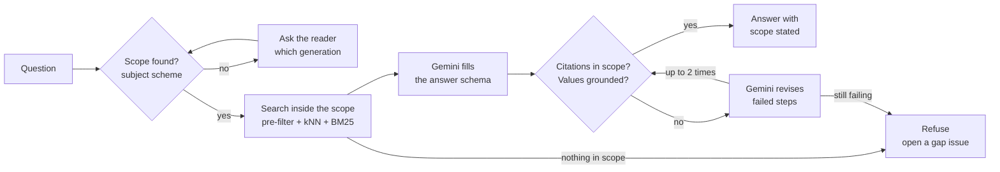

# VALID

**Answer from the docs for the generation you run, and refuse rather than
borrow from another.**

VALID (Version-Aware Lookup In DITA) is an agent that answers documentation
questions only from content that applies to the reader's hardware generation.
It reads the scope of every chunk from structure that writers already
maintain in DITA: profiling attributes, map cascading, and a subject scheme.
Firestore filters on that scope before the vector search runs, so content for
another generation never reaches the model. Plain Python checks every
citation and every value before the reader sees an answer. If nothing in
scope answers the question, VALID says so and opens a gap issue.

**[Read the design document](https://siddharthraop.github.io/VALID/)**

## Status

Design document, version 0.1 (October 2026). This repository contains the
design for a minimum viable product (MVP). The agent isn't built yet. The
simulator in the design document is a scripted demo and doesn't call a model.
The question set, similarity scores, costs, and scorecard values in the design
document are modeled, and they're labeled as modeled where they appear.

VALID is rebuilt from [VaultRAG](https://github.com/raosiddharthp/vaultrag),
a deployed RAG service on Cloud Run and Firestore Vector Search. It keeps
VaultRAG's retrieval stack and its refusal design.

## The problem

One question can have three right answers. These are the answers that Google
publishes for three Cloud TPU generations:

| Question | TPU v5p | TPU v6e (Trillium) | TPU7x (Ironwood) |
| -------- | ------- | ------------------ | ---------------- |
| Chips in one host or VM | 4 | 8 | 4 |
| Software version for the VM | `v2-alpha-tpuv5` | `v2-alpha-tpuv6e` | None. The Cloud TPU API doesn't support TPU7x. Use Compute Engine or GKE. |
| HBM per chip | 95 GiB | 32 GB | 192 GiB in the table, 192 GB in the prose |

Sources: [TPU v5p](https://docs.cloud.google.com/tpu/docs/v5p),
[TPU v6e](https://docs.cloud.google.com/tpu/docs/v6e),
[TPU7x](https://docs.cloud.google.com/tpu/docs/tpu7x), and
[TPU software versions](https://docs.cloud.google.com/tpu/docs/runtimes),
checked on October 20, 2026.

A retriever ranks text by meaning, not by generation. Ask "Which `--version`
do I pass for my Ironwood VM?" and the closest chunks are the v6e and v5p rows
of the software versions table. A model then picks a version string, and the
command fails.

This failure is measured. In the
[VersionRAG study](https://arxiv.org/html/2510.08109v1), standard RAG
answered 58% of version-sensitive questions correctly, and 25% of questions
about what changed between versions. The cost shows up in what readers do
next. In the
[2025 Stack Overflow Developer Survey](https://survey.stackoverflow.co/2025/ai),
66% of developers named answers that are "almost right, but not quite" as
their biggest frustration with AI tools, and 75.3% said they still ask a
person when they don't trust an AI answer.

The DITA source already records which content applies to which generation.
Publishing turns that scope into separate pages, and a standard assistant
indexes the pages, so the scope is lost.

### Why the usual fixes aren't enough

| Option | What it misses |
| ------ | -------------- |
| Tell the model the generation | Wrong-generation chunks are still in the context. |
| Boost or rerank by version | Wrong-generation chunks rank lower but still reach the model. |
| Filter after the search | Can leave no results, and the easy fix is to fall back to unfiltered ones. |
| One index per generation | Copies shared content into every index. |
| Model-built version graph | Rebuilds with a model what DITA authors already wrote. |
| **VALID: scope from the source, filter first** | **Depends on correct profiling, so it reports what isn't profiled.** |

## What it does

VALID has two parts:

-   **The index** runs on every docs merge. It reads the DITA source, gives
    each chunk a scope, reports shared text that holds a value for one
    generation, and writes vectors and scope fields to Firestore.
-   **The answer** runs on every question. It decides the scope from the
    subject scheme, searches only inside that scope, asks Gemini for a
    structured answer, and checks it.



### Scope comes from the source

VALID doesn't ask a model which generation a chunk belongs to. Writers already
answered that question when they profiled the content for DITAVAL builds.

| DITA feature | What VALID reads | Index result |
| ------------ | ---------------- | ------------ |
| [Map cascading](https://dita-lang.org/1.3/dita/archspec/base/cascading-in-a-ditamap) | `platform="tpu7x"` on a `<topicref>` | The whole branch is in scope for TPU7x |
| Element profiling | `platform` on a step, row, or section | That chunk's scope narrows |
| [No attribute](https://dita-lang.org/1.3/dita/archspec/base/filtering) | An omitted attribute can't evaluate to "exclude" | In scope for every generation, and audited |
| [Subject scheme](https://dita-lang.org/1.3/dita/archspec/base/controlled-values-for-attributes) | The allowed generations and their other names | One field per generation; any other value fails the build |

Unprofiled content is the risk. DITA treats it as shared, which is right for a
build and dangerous for an answer. The `audit_scope` tool finds shared chunks
that contain a value owned by one generation, such as a version string, and
opens an issue for the information architect.

### Design principles

-   **Filter first, then search.** The scope filter is part of every query.
    No code path removes it, and a failure is never retried without it.
-   **Structure first, model second.** Scope comes from the subject scheme and
    the DITA source. No model decides scope.
-   **The model answers. The checks decide.** Every citation must come from the
    retrieved, in-scope chunks, and every number, flag, command, and version
    string must appear in its source. The agent can't override the checks.
-   **A refusal is a designed outcome.** Each refusal says what is missing, so
    it becomes work for a writer instead of a dead end.

### Agent tools

The agent is built with
[Agent Development Kit](https://github.com/google/adk-python). It has nine
tools. Only one of them calls the model.

| Tool | Runs | Type | What it does |
| ---- | ---- | ---- | ------------ |
| `resolve_profiles` | Index | Deterministic | Resolves each chunk's scope from map cascading and element profiling |
| `audit_scope` | Index | Check | Finds shared chunks that hold a one-generation value and opens issues |
| `embed_chunks` | Index | Deterministic | Embeds changed chunks and writes vectors and scope fields |
| `resolve_scope` | Question | Deterministic | Matches the question against the subject scheme |
| `retrieve_in_scope` | Question | Deterministic | Runs the Firestore pre-filter and kNN, and BM25 in the same scope |
| `generate_answer` | Question | Model | Gemini fills an answer schema whose citations are an enum of retrieved chunk IDs |
| `check_answer` | Question | Check | Checks citations in scope, values grounded, and no out-of-scope values |
| `refuse_or_ask` | Question | Deterministic | Asks the reader for a generation, or refuses and opens a gap issue |
| `log_question` | Question | Deterministic | Logs scope, citations, check results, and cost to BigQuery |

## How you know it works

VALID is measured on a trap set: 60 questions whose correct answer differs
between v5p, v6e, and TPU7x, 10 questions that name no generation, and 10 that
name two. The same set runs against an unfiltered baseline built from the same
chunks.

| Metric | MVP target |
| ------ | ---------- |
| Wrong-generation answers that reach a reader | 0 |
| Citations in scope | 100% |
| Values grounded in the cited chunk | 100% |
| Scoped questions answered correctly | 54 of 60 or more; the rest refused, none wrong |
| Questions with no generation that get a choice, not an answer | 10 of 10 |
| Unscoped generation values left in the index after review | 0 |
| Median time to answer | Under 5 seconds |

**Known limits.** VALID is only as right as the profiling. It finds unscoped
values that it can recognize, such as version strings and key values, but not a
plain-language sentence that is wrong for one generation. Questions about what
changed between generations are out of scope for the MVP.

## Technology

The MVP runs on Google Cloud and free or open-source tools.

| Part | Technology | Free tier or license |
| ---- | ---------- | -------------------- |
| Agent framework | [Agent Development Kit](https://github.com/google/adk-python) | Apache 2.0 |
| Answer model | Gemini 3.8 Flash (`gemini-3.8-flash`) with [structured output](https://ai.google.dev/gemini-api/docs/structured-output) | [Gemini API free tier](https://ai.google.dev/gemini-api/docs/pricing) |
| Embeddings | [Gemini Embedding 2](https://ai.google.dev/gemini-api/docs/embeddings) (`gemini-embedding-2`), 1,536 dimensions | Gemini API |
| Vector store and scope filter | [Firestore vector search](https://docs.cloud.google.com/firestore/native/docs/vector-search) with composite vector indexes | [50,000 reads and 20,000 writes a day](https://cloud.google.com/firestore/pricing) |
| Exact-term search | [SQLite FTS5](https://www.sqlite.org/fts5.html#the_bm25_function) with BM25 | Public domain |
| Profiling and audit | Python and lxml | Open source |
| Index trigger | GitHub Actions | [Free for public repositories](https://docs.github.com/en/billing/concepts/product-billing/github-actions) |
| Agent runtime | Cloud Run service in `us-central1` | [180,000 vCPU-seconds a month](https://cloud.google.com/run/pricing) |
| Question log | BigQuery | [10 GiB storage and 1 TiB of queries a month](https://cloud.google.com/bigquery/pricing) |

**Data handling.** The sample content is public, so the Gemini API free tier
is acceptable for the MVP. Content sent on the free tier is used to improve
Google products, and paid-tier content isn't, so private documentation needs
the paid tier ([Gemini API pricing](https://ai.google.dev/gemini-api/docs/pricing)).

**Modeled cost.** At the Gemini 3.8 Flash introductory price, about $4 per
1,000 questions; at the standard price from January 1, 2027, about $8. The
design document shows the assumptions.

## View locally

The design document is a single HTML page with no build step.

1.  Clone the repository:

    ```sh
    git clone https://github.com/siddharthraop/VALID.git
    cd VALID
    ```

1.  Start a local web server:

    ```sh
    python3 -m http.server 8000
    ```

1.  In your browser, go to `http://localhost:8000`.

You can also open `index.html` directly in a browser.

## Repository contents

| File | Description |
| ---- | ----------- |
| `index.html` | The design document, published with GitHub Pages |
| `README.md` | This file |
| `LICENSE` | MIT License |
| `.gitignore` | Files that Git ignores |

## Sample content and attribution

The sample content is adapted from the Google Cloud TPU documentation:
[TPU7x (Ironwood)](https://docs.cloud.google.com/tpu/docs/tpu7x),
[TPU v6e](https://docs.cloud.google.com/tpu/docs/v6e),
[TPU v5p](https://docs.cloud.google.com/tpu/docs/v5p), and
[TPU software versions](https://docs.cloud.google.com/tpu/docs/runtimes).
Google publishes this content under the
[Creative Commons Attribution 4.0 License](https://creativecommons.org/licenses/by/4.0/),
as described in the
[Google Developers Site Policies](https://developers.google.com/site-policies).
The adapted content is modified from the original. The profiling attributes,
subject scheme, chunks, and sample answers are written for this design and
aren't part of Google's published pages.

The sample questions, issue numbers, similarity scores, and costs are written
for this design and aren't Google records or measured results.

This is a portfolio project. Google hasn't engaged, sponsored, or endorsed this
work. Stakeholders in the design document are job roles, not real people, and
the readers are fictional.

## Part of a series

This project is the sixth in a series of design documents. Each one solves one
economic problem in documentation, and each builds on the same sample content.

1.  [MANIFEST](https://siddharthraop.github.io/Manifest/): migrate DITA XML to
    docs as code and prove that no content was lost.
1.  [The Autonomous Author](https://siddharthraop.github.io/The-Autonomous-Author/):
    run the docs loop at the pace of the code loop, with a first draft on every
    merge.
1.  [KnowledgeFlow](https://siddharthraop.github.io/KnowledgeFlow/): answer
    questions across documentation silos, from the links writers already
    maintain.
1.  [AlignR](https://siddharthraop.github.io/AlignR/): generate new DITA topics
    from the ones you have, and check them against the schema before a writer
    sees them.
1.  [AEGIS](https://siddharthraop.github.io/AEGIS/): build regulator-ready
    evidence from the DITA source, and prove that each item is covered,
    current, and approved.
1.  **VALID**: answer from the docs for the generation you run, and refuse
    rather than borrow from another.

## Contact

Siddharth Rao. To ask a question or suggest a change,
[open an issue](https://github.com/siddharthraop/VALID/issues).

## License

The design document, diagrams, and code in this repository are licensed under
the [MIT License](LICENSE). Adapted Google content remains under the Creative
Commons Attribution 4.0 License.
