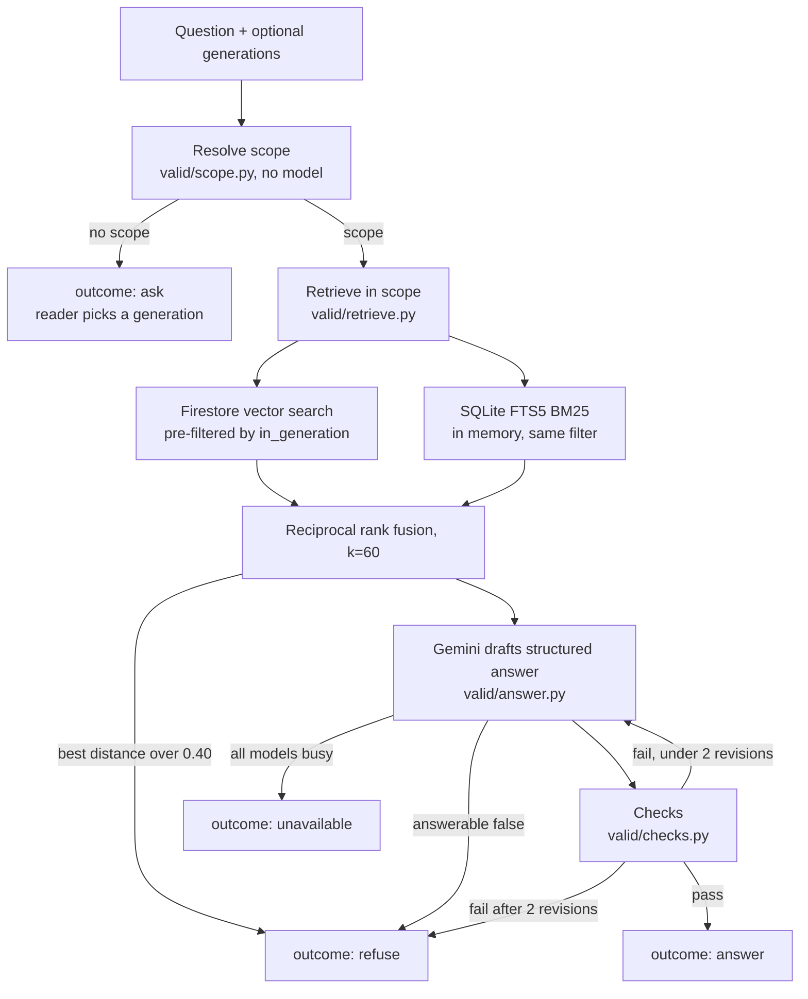

# VALID developer guide

VALID (Version-Aware Lookup In DITA) answers Cloud TPU questions using only the documentation for the TPU generation
the reader means, and shows its reasoning. This guide is for people who build, run or extend it.
The design rationale lives in the [design document](https://siddharthraop.github.io/VALID/); this guide
describes what is actually built, where it lives, and how to operate it.

- [Principles](#principles)
- [Architecture](#architecture)
- [Repository map](#repository-map)
- [Data: from DITA to Firestore](#data-from-dita-to-firestore)
- [The request path](#the-request-path)
- [Model resilience](#model-resilience)
- [Portal and API](#portal-and-api)
- [Configuration reference](#configuration-reference)
- [Local setup](#local-setup)
- [Scripts](#scripts)
- [Tests](#tests)
- [Deploy and operate](#deploy-and-operate)
- [Extending VALID](#extending-valid)
- [Known limits and roadmap](#known-limits-and-roadmap)

## Principles

These five rules decide most design questions. Code that breaks one is a bug.

1. **Filter first, then search.** The generation filter is applied before any vector or keyword search. No code path
   removes it, and `retrieve_in_scope` refuses to run with an empty scope.
2. **Scope comes from the source, not from a model.** The list of generations is read from the DITA subject scheme.
   The scope of a question is resolved by plain matching (`valid/scope.py`).
3. **The model answers; the checks decide.** Gemini drafts a structured answer. Plain Python (`valid/checks.py`)
   decides whether it is sent. The model cannot override a failed check.
4. **Refusal is a designed outcome.** When the in-scope documentation does not answer, VALID says so.
5. **Never widen the search to fix a failure.** A failed check triggers a rewrite (at most 2), never a broader search.

## Architecture



Runtime components:

| Component | Role | Cost posture |
| --- | --- | --- |
| Cloud Run service `valid` | Serves the page and `/api/*` | Max 1 instance, scales to zero, 512 Mi |
| Firestore (Standard) | Stores chunk text and 1,536-dim embeddings; vector search | Free tier |
| Gemini API (free-tier key) | Answer model chain and `gemini-embedding-2` | Free tier |
| Secret Manager | `gemini-key`, `valid-access-code` | Free tier |
| In-process SQLite FTS5 | Keyword search, built at startup from `data/chunks.jsonl` | No cost |

The service never reads Firestore at startup. Chunk text and keyword search come from `data/chunks.jsonl`; Firestore is
used only for the vector search per question.

## Repository map

| Path | What it is |
| --- | --- |
| `valid/config.py` | All settings, each overridable by an environment variable |
| `valid/scheme.py` | Reads the subject scheme: generations, their names and aliases |
| `valid/dita.py` | `resolve_profiles`: walks the maps, resolves conrefs and keyrefs, narrows `@platform` scope, builds chunks |
| `valid/audit.py` | `audit_scope`: flags chunks holding values owned by another generation and quarantines them |
| `valid/gemini.py` | Gemini client, document and query embedding with retries |
| `valid/store.py` | Firestore access: change detection, sync, scope-filtered vector search |
| `valid/scope.py` | `resolve_scope`: which generation(s) a question is about |
| `valid/bm25.py` | In-memory keyword index with the same scope columns |
| `valid/retrieve.py` | `Corpus` loader and `retrieve_in_scope` (vector + BM25 fused) |
| `valid/answer.py` | Prompt, answer schema, model chain with fallback and cooldown |
| `valid/checks.py` | `check_answer`: the three checks |
| `valid/agent.py` | `Agent.ask`: the whole flow, with the trace |
| `valid/web.py` | FastAPI app: page, API, access code, daily cap |
| `valid/static/index.html` | The portal (one file, no build step) |
| `data/` | `chunks.jsonl`, `owned.json`, `tpu-scheme.ditamap`, shipped in the container |
| `scripts/` | Index build, diagnostics, offline test suites |
| `Dockerfile`, `.dockerignore` | Container image for Cloud Run |
| `PROGRESS.md` | Project status and resource names |

## Data: from DITA to Firestore

The corpus is a separate repository, [dita-corpus](https://github.com/siddharthraop/dita-corpus), checked out next to
this one (`../dita-corpus`, or set `VALID_CORPUS`).

### Chunking and scope (`valid/dita.py`)

1. The root map (`tpu/tpu.ditamap`) is walked. `@platform` on topicrefs cascades to the topics beneath.
2. Conrefs are resolved (depth limit 6), then keyrefs. Values come from `tpu-keys.ditamap`.
3. Scope narrows by intersection at each level (map, topic, element). A value not in the subject scheme raises `ProfileError`.
4. Chunks are: a topic intro, section blocks grouped by identical scope, table rows grouped by scope (rendered
   `Header: value; …`), and each step as its own chunk. Ids look like `{topic_id}#{unit}[.n]`.
5. Each chunk records its `scope` (a list of generations), `origin` (`map`, `element` or `shared`), `path` and `line`.

### Audit and quarantine (`valid/audit.py`)

DITA treats content with no `@platform` as applying to everything. For a build that is right; for an answer it is dangerous.
`audit_scope` finds chunks that hold a value owned by a generation outside the chunk's scope (a version string,
a machine type, a key value). Those chunks are **quarantined**: never stored, never retrieved, and deleted from Firestore
if previously stored. This fails closed. The multi-generation table `tpu-generations-compared` is quarantined by design.

The audit recognises identifiers and key values, not a plain-language sentence that is wrong for one generation.

### Embeddings and Firestore (`valid/gemini.py`, `valid/store.py`)

- Model `gemini-embedding-2`, 1,536 dimensions. Documents are embedded as `title: {heading} | text: {text}`;
  queries as `task: search result | query: {question}`. There is no `task_type` parameter.
- Each stored document holds `id, topic_id, path, line, heading, text, scope, origin, kind, sig, embedding`, plus one boolean
  per generation: `in_v5e`, `in_v5p`, `in_v6e`, `in_tpu7x`.
- `sig` is `hash|model|dim`. `plan_sync` re-embeds only chunks whose signature changed, so a corpus edit costs a few embedding calls.
- Each generation has its own composite index: equality on `in_<gen>` plus the vector field (`scripts/create_indexes.py`).

### The shipped data (`scripts/export_data.py`)

`data/chunks.jsonl` holds the retrievable chunks (no vectors), `data/owned.json` the identifiers owned by exactly one
generation, and `data/tpu-scheme.ditamap` a copy of the subject scheme. They let the container run without the corpus.
Re-run `export_data.py` whenever the corpus changes, and copy the scheme file.

## The request path

`Agent.ask(question, generations=None)` in `valid/agent.py` returns one dict. Every step is recorded in `trace`.

1. **Scope.** If the caller supplied `generations` they are validated against the scheme. Otherwise `resolve_scope` matches
   generation names, aliases (Trillium, Ironwood) and generation-owned identifiers, longest term first, each span once.
   No match means outcome `ask`; the question is not sent anywhere.
2. **Retrieve.** `retrieve_in_scope` embeds the question once, then per generation runs the Firestore vector search and the BM25
   search (pool 8 each), fuses them with reciprocal rank fusion (k=60) and keeps `VALID_K` (default 6). If the best vector distance is
   above `VALID_MAX_DISTANCE` (0.40) the outcome is `refuse`.
3. **Generate.** `generate_answer` asks Gemini for JSON matching a schema where `cite` is an enum of the retrieved chunk ids and
   `generation` an enum of the scope, so the model cannot cite a chunk it was not given or answer for another generation.
   `answerable: false` ends in `refuse`. If chunks cover only some of the named generations, the model returns steps for those and
   states the gap in `missing`.
4. **Check.** `check_answer` runs three checks, all code:
   1. Every citation was retrieved for that step's generation and the chunk's scope includes it.
   2. Every flag, identifier, slice shape, number, unit, code span and exact command in a step appears in the cited chunk; values in the summary appear in the union of cited chunks.
   3. No identifier owned by an out-of-scope generation appears anywhere in the answer.
5. **Revise.** On failure the failures are fed back and the model tries again, at most `MAX_REVISIONS` (2) times. Then `refuse`.

Outcomes: `answer`, `ask`, `refuse`, `unavailable`. The result also carries `scope`, `matched`, `trace` and `run`
(model, calls, tokens, milliseconds, and the cost it would have if billed).

## Model resilience

The free tier is intermittently overloaded (503, 429, 504). `valid/answer.py` handles this explicitly.

- **Chain.** `MODEL_CHAIN` is tried in order: `gemini-3.8-flash`, `gemini-3.6-flash`, `gemini-3.5-flash`. The answering model is reported in the trace.
- **One attempt per call.** `http_options` sets a timeout and a single attempt, so the SDK never retries silently. The first model gets `VALID_FIRST_TIMEOUT` (15 s), the others `VALID_CALL_TIMEOUT` (20 s).
- **Cooldown.** A model that just failed is skipped for `VALID_COOLDOWN` (300 s), kept in a per-process dict. A fresh Cloud Run instance starts with none.
- **Quick second pass.** If models failed fast with 503 or 429 (not a timeout), they are retried once after 3 s.
- **Thinking level.** `VALID_THINKING` (default `LOW`). A model that rejects it (HTTP 400 mentioning "think") is retried without it.
- **Graceful failure.** If every model fails, `ModelUnavailable` becomes outcome `unavailable`. Nothing is answered, and the portal offers a retry.

## Portal and API

`valid/web.py` is a FastAPI app created by `create_app(agent=None, cap=None, access_code=None)`. The agent is built lazily on first request
(scheme, `Corpus.load`, Firestore client), which keeps import cheap and tests offline.

| Method and path | Purpose |
| --- | --- |
| `GET /` | The page (`valid/static/index.html`) |
| `GET /healthz` | Liveness: `{"ok": true}` |
| `GET /api/config` | Generations, questions left today, `needs_code`, limits, corpus link base |
| `POST /api/ask` | Body `{"question": str, "generations": [str] \| null}`; returns the `Agent.ask` dict plus `left_today` |

Errors: `400` (bad input, unknown generation, question over `VALID_MAX_CHARS`), `401` (access code), `429` (too many wrong codes, or daily cap), `500`.

- **Access code.** When `VALID_ACCESS_CODE` is set, `POST /api/ask` requires header `X-Access-Code`, compared in constant time.
  Eight wrong codes per client address in 15 minutes lock that address out (the address is the last `X-Forwarded-For` entry). When unset, the API is open, which is for local work only.
  The page reads `#code=…` from the URL fragment, which browsers never send to the server, stores it in `sessionStorage`, and clears the address bar.
- **Daily cap.** `Cap` counts questions per UTC day in memory (`VALID_DAILY_CAP`, 50). `ask` and `unavailable` outcomes are given back. It resets at 00:00 UTC and on restart.
- **Headers.** Every response sets a strict Content-Security-Policy (`default-src 'none'`, inline script and style, same-origin fetch), `X-Content-Type-Options` and `Referrer-Policy`. API docs and OpenAPI are disabled.
- **Page.** One HTML file, no build step, no external requests. All model and corpus text is inserted with `textContent`, never `innerHTML`.

## Configuration reference

All settings are environment variables read in `valid/config.py`. The Gemini key is read from `GEMINI_API_KEY` and is never stored in a file.

| Variable | Default | Purpose |
| --- | --- | --- |
| `GEMINI_API_KEY` | none | Free-tier Gemini key (Secret Manager in the cloud) |
| `VALID_PROJECT` | `valid-mvp-8425` | Google Cloud project for Firestore |
| `VALID_COLLECTION` | `chunks` | Firestore collection |
| `VALID_CORPUS` | `../dita-corpus` | Corpus checkout (local work only) |
| `VALID_ROOT_MAP`, `VALID_SCHEME` | `tpu/tpu.ditamap`, `tpu/subjects/tpu-scheme.ditamap` | Map and scheme paths inside the corpus |
| `VALID_ANSWER_MODEL` | `gemini-3.8-flash` | First model in the chain |
| `VALID_FALLBACK_MODEL`, `VALID_EXTRA_FALLBACK_MODEL` | `gemini-3.6-flash`, `gemini-3.5-flash` | Rest of the chain |
| `VALID_EMBED_MODEL`, `VALID_EMBED_DIM` | `gemini-embedding-2`, `1536` | Embeddings; changing either re-embeds everything |
| `VALID_K` | `6` | Chunks per generation sent to the model |
| `VALID_MAX_DISTANCE` | `0.40` | Refuse when the best cosine distance is above this |
| `VALID_THINKING` | `LOW` | Gemini thinking level |
| `VALID_FIRST_TIMEOUT`, `VALID_CALL_TIMEOUT` | `15`, `20` | Seconds per Gemini call |
| `VALID_COOLDOWN` | `300` | Seconds a failed model is skipped |
| `VALID_DAILY_CAP` | `50` | Questions per UTC day |
| `VALID_MAX_CHARS` | `400` | Longest accepted question |
| `VALID_ACCESS_CODE` | empty | Required code; empty means open |
| `VALID_CORPUS_WEB` | GitHub `dita-corpus` blob URL | Base for Source links |

## Local setup

Requirements: Python 3.11 or newer, `gcloud`, `git`, and a free-tier Gemini key from a project with no billing attached.

```bash
git clone https://github.com/siddharthraop/VALID.git ~/code/VALID
git clone https://github.com/siddharthraop/dita-corpus.git ~/code/dita-corpus
cd ~/code/VALID
python3 -m venv .venv && source .venv/bin/activate
pip install -r requirements.txt
gcloud auth application-default login            # Firestore access
gcloud auth application-default set-quota-project valid-mvp-8425
source start.sh                                  # activates the venv and prompts for GEMINI_API_KEY (hidden)
uvicorn valid.web:app --port 8080                # open http://127.0.0.1:8080
```

To build the index from scratch: `python scripts/create_indexes.py`, then `python scripts/index_build.py`, then `python scripts/export_data.py`.

## Scripts

| Script | Needs cloud? | Purpose |
| --- | --- | --- |
| `index_report.py` | No | Dry run of chunking and audit; `--show <text>` prints matching chunks |
| `export_data.py` | No | Writes `data/chunks.jsonl` and `data/owned.json` |
| `create_indexes.py` | Yes | Creates one Firestore vector index per generation (safe to re-run) |
| `index_build.py` | Yes | Embeds changed chunks and syncs Firestore; `--dry` plans only |
| `try_retrieve.py`, `try_search.py` | Yes | Inspect scope-filtered retrieval |
| `ask.py` | Yes | Ask from the terminal: `python scripts/ask.py "question" [gen[,gen]] [--trace]` |
| `calibrate.py` | Yes | Best distance for on-topic and off-topic questions (about 11 embedding calls) |
| `ping_models.py` | Yes | Which Gemini models answer quickly right now |

## Tests

Three offline suites run with no Google Cloud, no Gemini and no cost:

```bash
python scripts/check_offline.py   # scope resolution, BM25 isolation
python scripts/check_agent.py     # checks, agent loop, fallback, cooldown, retries, partial answers
python scripts/check_web.py       # API, daily cap, access code, lockout
```

Run all three before every deploy. They use a scripted model and a fake search, so they are fast and deterministic.
There is not yet an end-to-end evaluation against real questions; see the roadmap.

## Deploy and operate

Resource names are in `PROGRESS.md`. The service is deployed from source with Cloud Build:

```bash
P=valid-mvp-8425
gcloud run deploy valid --source . --project=$P --region=us-central1 \
  --service-account="valid-run@$P.iam.gserviceaccount.com" \
  --allow-unauthenticated --max-instances=1 --min-instances=0 \
  --memory=512Mi --cpu=1 --concurrency=4 --timeout=90 \
  --set-secrets=GEMINI_API_KEY=gemini-key:latest,VALID_ACCESS_CODE=valid-access-code:latest \
  --set-env-vars=VALID_PROJECT=$P,VALID_DAILY_CAP=50
```

`--set-secrets` replaces the whole list, so name both secrets every time.

**Cost guardrails.** A single instance that scales to zero, a daily question cap, a free-tier Gemini key, a small image, a cleanup policy that deletes
untagged images, and a budget alert on the billing account. A budget alert notifies; it does not stop spending.

**Common operations**

| Task | Command |
| --- | --- |
| Read logs | `gcloud run services logs read valid --region=us-central1 --project=$P --limit=30` |
| Change a setting | `gcloud run services update valid --region=us-central1 --project=$P --update-env-vars=VALID_K=8` |
| Rotate the access code | Add a new version: `printf %s "$NEW" \| gcloud secrets versions add valid-access-code --data-file=- --project=$P`, then redeploy or run `gcloud run services update valid --region=us-central1 --project=$P --update-secrets=VALID_ACCESS_CODE=valid-access-code:latest` |
| Update the data after a corpus change | `export_data.py`, copy the scheme, `index_build.py`, commit, deploy |

**Before every commit**, search the staged changes for a Google key: `git diff --cached | grep -cE "AIza[0-9A-Za-z_-]{30,}"` must print `0`.

## Extending VALID

**Add a generation.** Add it to the subject scheme in the corpus (the `platform` enumeration) with its `navtitle`. Name its keys with the generation key
as a prefix or suffix (`v7x-runtime`, `machine-type-v7x`) so `key_gen` can attribute them. Copy the scheme to `data/`, run `create_indexes.py` (a new
index), `index_build.py`, `export_data.py`, then the tests. Nothing in the code hard-codes a generation.

**Use a different corpus.** Set `VALID_CORPUS`, `VALID_ROOT_MAP` and `VALID_SCHEME`. The scope logic expects a subject scheme with an `enumerationdef` on `platform`.

**Change a model.** Set `VALID_ANSWER_MODEL` (and the fallbacks). Run `ping_models.py` first to see what answers on your key. Changing the embedding model or dimension re-embeds all chunks and requires new indexes.

**Add a check.** Add it in `valid/checks.py`, return failures with a `reason`, and add a case to `scripts/check_agent.py`. Failures are fed to the revision prompt automatically.

**Tune refusal.** `VALID_MAX_DISTANCE` is a floor, not a judge: on this corpus an in-domain-but-absent question (0.279) and an on-topic one (up to 0.283) are not separable by distance. The model's `answerable` flag covers that gap.

## Known limits and roadmap

- **Free-tier latency.** Replies take 2 to 3 seconds when the models are quiet and 10 to 35 seconds when they are not. The design's under-5-second median is not met on the free tier.
- **Per-process state.** The cooldown and the daily cap live in memory and reset on a new instance.
- **Audit scope.** The audit recognises identifiers and key values, not a wrong plain-language sentence.
- **Per VM versus per host.** The answer model is told to use only stated facts. A lead sentence can still blur the two, even though every cited step is accurate.
- **Retrieval depth.** The best chunk for some questions sits just outside the top 6. `VALID_K=8` is a cheap mitigation.
- **Not built yet:** BigQuery question log and GitHub issues for documentation gaps; an ADK wrapper; a trap-set evaluation against the design's section 7 metrics; automatic index builds on corpus change (GitHub Actions).

## Attribution

`data/chunks.jsonl`, `data/owned.json` and `data/tpu-scheme.ditamap` are derived from
[siddharthraop/dita-corpus](https://github.com/siddharthraop/dita-corpus). Credit and licence terms for that content are those of that repository.
